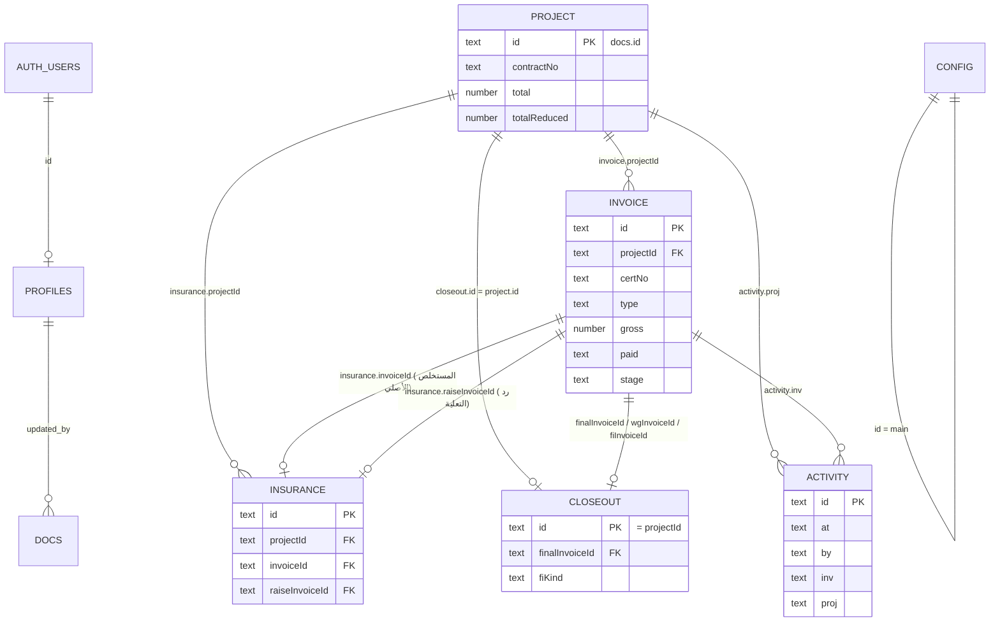

# DATABASE DOCUMENTATION — قاعدة البيانات

> تاريخ الإعداد: 2026-11-09
> **مصادر المعلومات:**
> 1. نص الـ migrations الفعلي اللي اتنفذ على المشروع وقت الإعداد (2026-11-07) من سجل جلسة Claude.
> 2. قراءة حية للبيانات من البرنامج المنشور (read-only) بتاريخ 2026-11-09.
> 3. الكود (`src/shim.js`, `src/app.html`).
>
> **مهم:** موصّل Supabase في جلسة Claude الحالية بقى متوصل بحساب Supabase **تاني** (فيه مشروعين اسمهم `yawmeya` و`taqsit`)، فمكنتش أقدر أقرا كتالوج قاعدة البيانات مباشرة. اللي محتاج تأكيد من لوحة التحكم مكتوب عليه **NEEDS VERIFICATION**.

## 1. البطاقة
| البند | القيمة | الثقة |
|---|---|---|
| النوع | PostgreSQL مُدار (Cloud) | VERIFIED |
| المزود | Supabase | VERIFIED |
| اسم المشروع | `mostakhlasat` | VERIFIED |
| Project ref / Instance | `vaoubvghpktwjpdzdjnu` | VERIFIED (موجود في `src/shim.js`) |
| عنوان الـ API | `https://vaoubvghpktwjpdzdjnu.supabase.co` | VERIFIED |
| المنطقة | `eu-central-1` (فرانكفورت) | VERIFIED وقت الإنشاء، وNEEDS VERIFICATION حالياً |
| المنظمة (Organization) | id `gjvloclurhutretebrwi` | VERIFIED وقت الإنشاء |
| حساب Supabase المالك | INFERRED: الحساب اللي إيميله `eldamamfacility@gmail.com` (المستخدم دخل بيه وقت الإنشاء) | NEEDS VERIFICATION |
| اسم قاعدة البيانات | `postgres` (الافتراضي في Supabase) | INFERRED |
| إصدار Postgres | UNKNOWN | من Dashboard ← Settings ← Infrastructure |
| الخطة (Free/Pro) | UNKNOWN، والأرجح Free | NEEDS VERIFICATION. مهم لأن مشاريع Free بتتوقف مؤقتاً لو فضلت فترة من غير استخدام |
| لوحة التحكم | https://supabase.com/dashboard/project/vaoubvghpktwjpdzdjnu | VERIFIED (الشكل القياسي للرابط) |
| بيئات منفصلة (dev/test/prod) | **لأ.** فيه قاعدة واحدة بس، والتجربة كانت بتتعمل على البيانات الحقيقية | VERIFIED |
| حجم البيانات | حوالي 150 KB من JSON (318 صف في `docs`) | VERIFIED (2026-11-09) |

**مشروع Supabase تاني على نفس المنظمة (تنبيه):** وقت الإعداد كان فيه على نفس الحساب مشروع Supabase قديم فيه جداول `projects` و`extracts`. **مش تبع البرنامج ده ومتلمسوش.** المعلومة دي INFERRED من وقت الإعداد.

## 2. الوصول
1. ادخل https://supabase.com/dashboard بحساب Supabase المالك (الإيميل المحتمل فوق).
2. افتح مشروع `mostakhlasat`.
3. **Table Editor** لعرض الجداول، و**SQL Editor** للاستعلامات، و**Authentication** للمستخدمين.

**بيانات الاتصال:**
- عنوان الـ API ومفتاح publishable: في `src/shim.js`. الاتنين عامين بطبيعتهم.
- كلمة سر قاعدة البيانات (`postgres`) ومفاتيح `service_role` / secret: **مش موجودين في المستودع**. بتتجاب من Dashboard ← Project Settings ← Database / API Keys.

## 3. الجداول (schema `public`)
### 3.1 `public.docs`: كل بيانات البرنامج
| العمود | النوع | قيود | الوظيفة |
|---|---|---|---|
| `collection` | text | NOT NULL، جزء من PK | اسم المجموعة |
| `id` | text | NOT NULL، جزء من PK | رقم المستند (15 حرف عشوائي، أو أرقام قديمة زي `i017` و`c053`) |
| `data` | jsonb | NOT NULL، الافتراضي `{}` | محتوى المستند |
| `version` | integer | NOT NULL، الافتراضي 1 | بيزيد 1 مع كل UPDATE (trigger)، ومستخدم في منع تعارض الكتابة |
| `updated_at` | timestamptz | NOT NULL، الافتراضي now() | بيتحدث في كل كتابة (trigger)، ومستخدم في المزامنة |
| `updated_by` | uuid | يقبل NULL | `auth.uid()` لآخر كاتب (trigger) |
| `deleted` | boolean | NOT NULL، الافتراضي false | حذف ناعم |

- **PK:** `(collection, id)`
- **Indexes:** `docs_collection_idx (collection)` و`docs_updated_at_idx (updated_at)`
- **Trigger:** `docs_touch` BEFORE INSERT OR UPDATE، بينفذ `public.docs_touch()`
- **Realtime:** الجدول مضاف لـ publication `supabase_realtime`

### 3.2 `public.profiles`: مستخدمين البرنامج
| العمود | النوع | قيود |
|---|---|---|
| `id` | uuid | PK، و`references auth.users(id) on delete cascade` |
| `name` | text | NOT NULL، الافتراضي '' |
| `role` | text | NOT NULL، الافتراضي 'viewer'، و`check (role in ('admin','editor','viewer'))` |
| `created_at` | timestamptz | NOT NULL، الافتراضي now() |

الصفوف الحالية: 2، الاتنين `admin` («المدير» و«خالد»).

### 3.3 جداول Supabase الداخلية المستخدمة
`auth.users` و`auth.identities`: حسابات الدخول. بتتدار من Dashboard ← Authentication.

## 4. المجموعات داخل `docs` (الهيكل المنطقي) — VERIFIED من البيانات الحية
| collection | العدد (2026-11-09) | الحقول الفعلية |
|---|---|---|
| `projects` | 67 | `contractNo, name, shortName, location, dept, company, unifiedCode, contractDate, boqNo, total, totalReduced, reduced, reducedDate, insFileNo, wageRatio, notes, order, updatedAt` |
| `invoices` | 136 (+2 محذوفين) | `projectId, certNo, type, gross, date, paid, paidDate, bankExpected, insStatus, insPaid, insRaise, insRaiseDate, mpStatus, mpEstimate, showSat, showMp, notes, stage, stageDate, stageLog[], materials[], materialsNote, company, log[], order, updatedAt, updatedBy` (+ `dateLog[]` لما يتعدل تاريخ الختامي) |
| `insurance` | 17 | `projectId, invoiceId, raiseInvoiceId, fileNo, requests[], status, statusText, amountDue, required, owner, nextDate, log[], calcBase, calcTax, calcWage, order, updatedAt, updatedBy` |
| `closeout` | 10 | `projectId` (= رقم المستند)، `finalInvoiceId, handoverDate, wgInvoiceId, wgAmount, wgSubmitted, wgPayments[], wgSettled, wgNote, fiKind ('cash'/'lg'), fiInvoiceId, fiAmount, fiSubmitted, fiPayments[], fiSettled, fiNote, fiLgNo, fiLgBank, fiLgExpiry, fiLgReturned, log[], updatedAt, updatedBy` |
| `activity` | 86 | `at, by, inv, proj, text` (سجل التعديلات، والبرنامج بيعرض آخر 300) |
| `config` | 1 (id = `main`) | `title, currency, lateDays, depts[{name, hasStages, mp}], stages[], types[], companies[], insStatuses[], mpPct, defWage, mpBase` |
| `zz_test` | 1 (محذوف ناعم) | بقايا اختبار مزامنة. ملوش لازمة |

**ملاحظات على القيم:**
- `paid`: «نعم» أو «لا» أو فاضي.
- `insStatus`: «نعم» أو «لا» أو «تعلية» أو «لا حاجة».
- `type`: من `config.types` (مستخلص أعمال، تعلية تأمينات اجتماعية، رد ضمان أعمال، رد تأمين نهائي، فرق مصرح بصرفة).
- التواريخ نص بصيغة `YYYY-MM-DD`.

## 5. ERD
العلاقات بين المستندات **منطقية جوه JSON** (من غير Foreign Keys في Postgres):

**تنبيه:** مسح مشروع أو مستخلص مش بيمسح اللي مربوط بيه تلقائياً. البرنامج بيمنع مسح مشروع عليه مستخلصات.

## 6. الدوال والـ Triggers والصلاحيات (نص الـ migrations الفعلي)
### Migration 1: `init_docs_profiles` (2026-11-07)
```sql
create table public.profiles (
  id uuid primary key references auth.users(id) on delete cascade,
  name text not null default '',
  role text not null default 'viewer' check (role in ('admin','editor','viewer')),
  created_at timestamptz not null default now()
);
create table public.docs (
  collection text not null, id text not null,
  data jsonb not null default '{}'::jsonb,
  version integer not null default 1,
  updated_at timestamptz not null default now(),
  updated_by uuid,
  primary key (collection, id)
);
create index docs_collection_idx on public.docs(collection);

create or replace function public.my_role() returns text
language sql stable security definer set search_path = public as $$
  select role from public.profiles where id = auth.uid()
$$;
revoke all on function public.my_role() from public, anon;
grant execute on function public.my_role() to authenticated;

create or replace function public.docs_touch() returns trigger
language plpgsql set search_path = public as $$
begin
  new.updated_at := now();
  new.updated_by := auth.uid();
  if tg_op = 'UPDATE' then new.version := old.version + 1; end if;
  return new;
end $$;
create trigger docs_touch before insert or update on public.docs
  for each row execute function public.docs_touch();

alter table public.profiles enable row level security;
alter table public.docs enable row level security;

create policy "profiles read (members)" on public.profiles for select to authenticated using (public.my_role() is not null);
create policy "profiles admin insert" on public.profiles for insert to authenticated with check (public.my_role() = 'admin');
create policy "profiles admin update" on public.profiles for update to authenticated using (public.my_role() = 'admin') with check (public.my_role() = 'admin');
create policy "profiles self name"   on public.profiles for update to authenticated using (id = auth.uid()) with check (id = auth.uid() and role = public.my_role());
create policy "profiles admin delete" on public.profiles for delete to authenticated using (public.my_role() = 'admin');

create policy "docs read (members)"   on public.docs for select to authenticated using (public.my_role() is not null);
create policy "docs insert (editors)" on public.docs for insert to authenticated with check (public.my_role() in ('admin','editor'));
create policy "docs update (editors)" on public.docs for update to authenticated using (public.my_role() in ('admin','editor')) with check (public.my_role() in ('admin','editor'));
create policy "docs delete (editors)" on public.docs for delete to authenticated using (public.my_role() in ('admin','editor'));

revoke all on public.docs, public.profiles from anon;
alter publication supabase_realtime add table public.docs;
```
### Migration 2: `offline_sync_support` (2026-11-07)
```sql
alter table public.docs add column if not exists deleted boolean not null default false;
create index if not exists docs_updated_at_idx on public.docs(updated_at);
```
- **Views:** مفيش.
- **Functions:** `my_role()` و`docs_touch()` بس.

**عشان تتأكد إن مفيش تغييرات حصلت بعد كده (NEEDS VERIFICATION):** نفّذ في SQL Editor:
```sql
select * from supabase_migrations.schema_migrations order by version;
select policyname, cmd, roles from pg_policies where schemaname='public';
select tgname from pg_trigger where tgrelid='public.docs'::regclass and not tgisinternal;
```

## 7. تنفيذ التغييرات على قاعدة البيانات
- **إضافة حقل للبيانات:** مش محتاجة migration. الحقل بيتضاف في JSON من الكود.
- **تغيير هيكل حقيقي** (جدول جديد أو policy): اكتب SQL ونفّذه من Dashboard ← SQL Editor، أو بـ Supabase CLI (`supabase migration new` ثم `supabase db push`). **احفظ نص الـ SQL في المستودع**، لأن مفيش فولدر migrations حالياً، فأنشئ `supabase/migrations/` لو احتجت.
- **ممنوع:** تعديل `version` أو `updated_at` يدوياً، لأن ده بيبوّظ المزامنة. وممنوع المسح الحقيقي لمستند (`delete from docs`) والأجهزة شغالة: استخدم `deleted=true` عشان الحذف يوصل لكل الأجهزة.

## 8. التصدير والنسخ الاحتياطي والاستعادة
التفاصيل في [BACKUP_AND_RECOVERY](BACKUP_AND_RECOVERY.md). باختصار:
- **أسهل طريقة:** SQL Editor ← `select * from public.docs;` ← Export CSV. وبرضه `profiles`.
- **نسخة كاملة:** `pg_dump` أو `supabase db dump` بكلمة سر قاعدة البيانات من Dashboard.
- **من جوه البرنامج:** زرار Excel في القائمة الجانبية بينزّل نسخة احتياطية. **لكنها ناقصة:** فيها المشاريع والمستخلصات والخامات والحركة بس، ومن غير التأمينات وما بعد الختامي والإعدادات وسجل النشاط.
- **النسخ التلقائي في Supabase:** UNKNOWN حسب الخطة. Dashboard ← Database ← Backups.


## 9. حقول اتضافت 2026-11-11
`invoices`: `readyPay`, `readyPayDate`, `mpDate`, `insDate` · `projects`: `milestones[]`, `insFileDate` · `config/main`: `projSteps[]`. كلها جوه JSON ومن غير migration. التفاصيل في [UPDATE_2026-11-11](UPDATE_2026-11-11.md).
