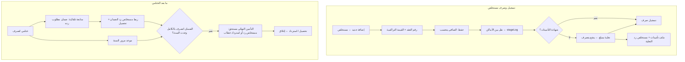

# FEATURES AND WORKFLOWS — دليل الوظائف ودورات العمل

> تاريخ الإعداد: 2026-11-09 · اتأكدت من وجود كل وظيفة هنا في الكود على `main` (commit `07e8ad8`). وأغلبها اتجرب بالمتصفح الآلي أثناء التطوير.
> كل الشاشات في ملف واحد: `src/app.html`. والصلاحية المطلوبة للتعديل `admin` أو `editor`، و`viewer` بيشوف بس.
> **الجداول المرتبطة:** كل الشاشات بتقرا وتكتب في `public.docs`. الـ collection بتاع كل شاشة مكتوب جنبها.

## 0. عناصر مشتركة
| العنصر | الوصف | الكود |
|---|---|---|
| القائمة الجانبية | 8 تبويبات + «إضافة جديد» (مستخلص / مشروع / ملف تأمينات) + بحث سريع (Ctrl K) + الإعدادات + Excel الاحتياطي + تصغير + كلمة السر + خروج + تثبيت + مؤشر المزامنة. على الموبايل بتبقى درج بيتفتح بزرار ☰ | `aside.side`, `applySide`, `shim.addAccountButtons` |
| النافذة الجانبية | كل الإضافة والتعديل بيبقى فيها. فيها زرار تصغير (−) يحفظ اللي اتكتب ويرجعلها بعدين، ولو فيه كتابة الضغط برا النافذة أو Esc بيصغّرها بدل ما يقفلها | `openDlg`, `minimizeDlg`, `restoreDlg` |
| البحث برقم العقد | قائمة بتتفلتر بالرقم أو الاسم أو المقايسة | `input[data-cpick]` |
| خانات التاريخ | كتابة حرة يوم/شهر/سنة + تقويم، والقيمة بتتحفظ YYYY-MM-DD | `.dwrap` |
| العمليات الجماعية | لما تحدد مستخلصات: نقل لمكان، تسجيل صرف، شهادة تأمينات، إضافة أو إزالة من كشف المتابعة أو كشف القوة العاملة، تنزيل Excel، تحديد الكل | `#bulk`, `runBulk` |
| سجل النشاط | أي حفظ بيتسجل في `activity` باسم المستخدم | `logAct` |
| الشغل من غير نت | كل حاجة شغالة أوفلاين، والمؤشر بيبين عدد التعديلات المنتظرة | `src/shim.js` |

## 1. نظرة عامة: `home`
- **الغرض:** صورة سريعة للمستحقات.
- **المحتوى:**
  - 4 مؤشرات: غير المصروف، المصروف، المتأخر، بدون شهادة تأمينات.
  - لوحة «مستحقات الشركة بعد الختامي».
  - رسوم أعمدة لغير المصروف حسب المكان وحسب الإدارة.
  - مدة البقاء، وأكبر المشاريع.
  - حركة آخر 7 أيام، وآخر التعديلات.
- **الإجراءات:** الضغط على أي صف بيفتح الكشف مفلتر.
- **الكود:** `renderHome`, `goReg`, `coKpisHtml`.
- **الـ collections:** invoices, projects, activity, closeout.

## 2. كشف المتابعة: `sat`
- **الغرض:** المستخلصات الجارية المعلّم عليها `showSat=true`.
- **العرض:** مجمّعة إدارة ← مكان ← شركة (`satLevels`)، أو حسب المكان أو الشركة. اسم المشروع مختصر أو كامل.
- **الفلاتر:** الإدارة، المكان، الشركة، الموقع، النوع، وتنبيهات (متأخر، بدون شهادة، قوة عاملة لم تُستخرج، لم يُصرف).
- **أرقام فوق الكشف:**
  - الإجمالي، ولم يُصرف، وبعد الخامات، والمتوقع للبنك.
  - «توزيع على الأماكن»: الأماكن الفرعية زي «الإدارة (تموين)» بتظهر شارات جوه كارت «الإدارة».
  - جدول الإدارة × المكان.
- **الصف:** المشروع وأرقامه، والقيمة ونسبة التنفيذ، وعلامات الصرف والتأمينات والقوة العاملة، والمكان ومن إمتى، والأيام. وتحته آخر متابعة والملاحظات.
- **التصدير:** Excel منسّق (`exportSatXlsx`)، وتقرير PDF بجدول لكل مرحلة (`buildSatPdf`).
- **الحساب:** «متأخر» لو الأيام في المكان أكتر من `config.lateDays`.

## 3. حركة المستخلصات: `moves`
- **الغرض:** تاريخ تنقلات المستخلصات (`stageLog`) والصرف.
- **الفلاتر:** الفترة (أسبوع، شهر، 3 شهور، الكل)، والمكان، والنوع، والبحث.
- **المحتوى:** مؤشرات، وجدول «مدة البقاء في كل مكان» (`stayStats`)، وسجل يومي.
- **الإجراءات:**
  - «تسجيل حركة جديدة» من نافذة المستخلص (`moveDialog`).
  - التراجع عن حركة (`undoMove`).
  - Excel (`exportMovesXlsx`).

## 4. سجل المستخلصات: `inv`
- **الغرض:** كل المستخلصات.
- **التجميع:** المشروع (الافتراضي)، أو الإدارة، أو المكان، أو الشركة، أو من غير تجميع. ومعاه طي المجموعات.
- **الترتيب:** الأحدث أو الأقدم.
- **الفلاتر:** البحث، والشركة، والإدارة، والمكان، والنوع، و«في كشف المتابعة فقط»، و«في كشف القوة العاملة فقط»، وشارات الصرف.
- **الإجراءات:** فتح المستخلص، والتحديد والعمليات الجماعية، وExcel (`exportInvXlsx`).

### نافذة المستخلص (`invDialog`)
**الحقول:**
| المجموعة | الحقول |
|---|---|
| البيانات الأساسية | رقم العقد، رقم المستخلص (`certNo`)، النوع، القيمة الإجمالية التراكمية (`gross`)، التاريخ |
| الخامات المخصومة | `materials[]`: اسم، كمية، سعر، والإجمالي بيتحسب |
| الصرف والشهادات | حالة الصرف وتاريخه، المتوقع للبنك، شهادة التأمينات (نعم / لا / تعلية + مبلغ وتاريخ / لا حاجة)، مبلغ التأمينات المدفوع، شهادة القوة العاملة، تقدير المكتب |
| المكان | المكان الحالي وتاريخ دخوله، والأيام، والخط الزمني للحركة |
| مستحقات ما بعد الختامي | قسم بيظهر للختامي ولمستخلصات الرد، فيه الحالة وزرار «فتح المتابعة» |
| الكشوف والملاحظات | عرض في كشف المتابعة أو كشف القوة العاملة، وملاحظات الكشف، والشركة لو مختلفة عن شركة المشروع |
| سجل المتابعة | `log[]`: تاريخ، مستخدم، نص |
| سجل التعديلات | من `activity` |

**القواعد:**
- رقم المستخلص مطلوب لمستخلص الأعمال.
- ممنوع تكرار رقم المستخلص بنفس النوع على نفس العقد.
- الصرف من غير تاريخ ← البرنامج بيحط تاريخ النهارده.
- تغيير المكان بيضيف سطر في `stageLog`.
- **تعديل تاريخ مستخلص ختامي له تاريخ سابق محتاج سبب**، وبيتسجل في `dateLog`.

**المعادلات (`calc`):**
- الصافي = الإجمالي − إجمالي المستخلص السابق (لمستخلصات الأعمال).
- بعد الخامات = الصافي − Σ(كمية × سعر).
- نسبة التنفيذ = الإجمالي ÷ قيمة العقد.

## 5. المشاريع: `proj`
- **العرض:** بطاقات أو جدول، مجمّعة حسب الإدارة أو الشركة أو من غير تجميع.
- **الترتيب:** حسب المستحقات أو غيرها.
- **حالة كل مشروع:** متأخر، عليه مستحقات، منتظم، مكتمل، بدون مستخلصات (`projStats`).

### نافذة المشروع (`projDialog`)
- **مستخلصات المشروع:** جدول + «مستخلص جديد».
- **ضمانات ومستحقات ما بعد الختامي:** ملخص + زرار.
- **بيانات المشروع:** رقم العقد، الاسم، الاسم المختصر، الموقع، جهة الإسناد، الشركة، الكود الموحد، تاريخ العقد، رقم المقايسة.
- **القيم:**
  - إجمالي أعمال العقد.
  - خانة «تم تخفيض قيمة العقد»، ولو متعلّم عليها: القيمة بعد التخفيض وتاريخ إخطار الخفض (`reduced`, `totalReduced`, `reducedDate`).
  - رقم ملف التأمينات، ونسبة الأجور، والملاحظات.

**القواعد:**
- رقم العقد مطلوب ومش بيتكرر.
- مسح مشروع عليه مستخلصات ممنوع.
- لو شيلت علامة التخفيض، القيمة بعد التخفيض والتاريخ بيتمسحوا.

## 6. التأمينات الاجتماعية: `ins` (collection `insurance`)
- **المؤشرات:** ملفات تحت المتابعة، والمبالغ المطلوب دفعها، والمتابعات المتأخرة، والمستخلصات في انتظار الشهادة.
- **الشارات:** حسب الحالة (`config.insStatuses`)، و«الشهادات المستخرجة». الملفات اللي شهادتها طلعت بتختفي من الكشف (`insCertDone`).
- **الجدول:**
  - المشروع.
  - المستخلص الأصلي وموقفه، ومستخلص رد التعلية.
  - **المطلوب دفعه للتأمينات**، ورقم الملف والطلبات (CS).
  - الوضع الحالي والمطلوب، والمتابعة.
- **«مستخلصات تحتاج ملف متابعة»:** اقتراحات.
- **التصدير:** Excel، ونسخة للطباعة.

### نافذة ملف التأمينات (`insDialog`)
- **البيانات الأساسية:** رقم العقد، المستخلص الأصلي، مستخلص رد التعلية (بيتعرف لوحده)، رقم الملف، الحالة، المبلغ المطلوب دفعه، المسؤول، موعد المتابعة، الوضع، المطلوب.
- **حاسبة التأمينات:**
  - الوعاء = القيمة × 100 ÷ (100 + الضريبة، والافتراضي 14).
  - التأمينات = الوعاء × نسبة العمالة × 18.25%.
  - زرار «استخدمها كمبلغ مطلوب دفعه».
- **أرقام الطلبات CS** (`requests[]`)، وجدول مستخلصات المشروع (الضغط عليه بيربط المستخلص)، وسجل المتابعة.

**القواعد:**
- مستخلص واحد = ملف واحد.
- مستخلص رد التعلية مرتبط بملف واحد بس.
- رد التعلية «لا يُصرف قبل دفع تأمينات الأصلي» لحد ما تطلع شهادة الأصلي أو الملف يخلص (`raiseReady`).

## 7. مستحقات ما بعد الختامي: `co` (collection `closeout`)
- **المؤشرات:** إجمالي المستحقات النقدية بعد الختامي (ومعاه عدد خطابات الضمان اللي لسه ما اتستردتش وقيمتها)، وضمان أعمال مطلوب رده، وقيمته، والتأمينات النهائية القريبة (30 يوم)، والمستحقة.
- **التنبيهات:** مترتبة عاجل ← متابعة ← معلومة ← بيانات ناقصة، وكل تنبيه بيفتح المشروع.
- **الشارات:** مفتوحة، ضمان مطلوب، تأمين قرب موعده، تأمين مستحق، قيد الصرف، صرف جزئي، بيانات ناقصة، مغلق.
- **الفلاتر:** بحث، شركة، جهة إسناد، تاريخ استحقاق من وإلى.
- **الجدول، وExcel، وطباعة.**

### القواعد (`coCompute`)
**المتابعة بتبدأ لوحدها** لأي مشروع مستخلصه الختامي (رقمه فيه «ختامي») متعلّم «اتصرف».

**التسليم الابتدائي:**
- بيتاخد من تاريخ المستخلص الختامي، إلا لو اتكتب تاريخ مختلف (والتعديل محتاج سبب).
- لو مفيش تاريخ ← «بيانات ناقصة».

**رد ضمان الأعمال:**
- مستخلص من نوع «رد ضمان أعمال» (بيتعرف لوحده).
- التحصيل على دفعات (`wgPayments`)، أو المستخلص متعلّم «اتصرف»، أو تسوية معتمدة.

**التأمين النهائي:**
- `fiKind = cash`:
  - القيمة الافتراضية 5% من قيمة العقد.
  - بيتابع بمستخلص «رد تأمين نهائي» وتحصيل على دفعات.
- `fiKind = lg` (خطاب ضمان):
  - رقم الخطاب، والبنك، والقيمة، وتاريخ الانتهاء، وطلب الاسترداد، وتاريخ الاسترداد.
  - مش بيدخل في الإجمالي النقدي.
- **موعد مرور السنة** = التسليم الابتدائي + سنة (29 فبراير ← 28 فبراير).
- **تاريخ الإتاحة** = الأبعد بين (موعد مرور السنة) و(تاريخ صرف ضمان الأعمال **بالكامل**).

**التنبيهات:**
- ضمان مطلوب رده (عاجل بعد `lateDays` يوم من صرف الختامي).
- ضمان مقدم ولم يُصرف.
- صرف جزئي.
- تأمين قرب موعده خلال 30 يوم.
- حل موعده وفي انتظار الضمان.
- مستحق ولم يُطالب به.
- مقدم ولم يُصرف.
- خطاب ضمان ينتهي خلال 30 يوم أو انتهى.
- بيانات ناقصة.

**الإغلاق:** لما الاتنين يتحصلوا بالكامل أو يتقفلوا بتسوية معتمدة.

**نافذة المتابعة (`coDialog`):** الموقف، والختامي والتسليم، ورد الضمان، ورد التأمين (النوع وحقوله والتواريخ المحسوبة والتحصيل)، وسجل المراجعة (`log[]`) لكل تغيير في التواريخ أو القيم.

## 8. القوة العاملة: `mp`
- **الغرض:** المستخلصات المعلّم عليها `showMp`.
- **الحساب (`mpRow`):**
  - الأساس:
    - قيمة العقد، لو الجهة متعلّم عليها «ق.ع على إجمالي العقد».
    - وإلا الصافي أو الإجمالي حسب `config.mpBase`.
  - نسبة الأجور = نسبة المشروع، أو الافتراضية `config.defWage` (0.2).
  - المتوقع = max(0, الأساس × نسبة الأجور × `config.mpPct` (0.03) − المسدد سابقاً على نفس العقد).
  - المعتمد = تقدير المكتب لو موجود.
- **نافذة `mpDialog`:** العقد، والمستخلص المربوط، وشهادة القوة العاملة، وتقدير المكتب، وتاريخ السداد، والملاحظة.
- **زرار «النسب»** بيفتح الإعدادات.
- **التصدير:** Excel.

## 9. الإعدادات (`settingsDialog`, collection `config`, id `main`)
- العنوان، وحد التأخير، والعملة.
- جهات الإسناد، ولكل جهة: ليها مراحل؟ ق.ع على إجمالي العقد؟
- أماكن المستخلص، والأنواع، والشركات، وحالات ملف التأمينات.
- نسبة القوة العاملة، ونسبة الأجور الافتراضية، وأساس الحساب.

**التعديلات هنا بتظهر لكل المستخدمين.**

## 10. دورات العمل الرئيسية

## 11. حالات استثنائية وأخطاء معروفة
| الحالة | سلوك البرنامج |
|---|---|
| مستخدم من غير صف في `profiles` | خروج تلقائي + «الحساب ده مش مفعّل في البرنامج» |
| `viewer` بيحاول يعدّل | الحفظ بيترفض و«لا تملك صلاحية التعديل» |
| تعديل نفس المستند من جهازين | دمج على مستوى الحقل؛ لو نفس الحقل ← آخر كتابة تكسب + تنبيه «اتدمجت تعديلاتك» |
| تاريخ بصيغة غلط في بيانات قديمة | `isoDate()` بتعامله كأنه مش موجود |
| أول دخول من غير نت | «أول دخول محتاج إنترنت» |
| رابط لصفحة جديدة تحت نفس المسار | بيفتح البرنامج القديم من الكاش (قيد في الـ Service Worker) |

## 12. إضافات 2026-11-11
صفحة **سجل الحركات اليومي** (`act`)، و5 مراحل للمستخلص، وخانة جاهز للصرف، والبحث في كشف المتابعة، وخانات المشروع المقفولة بالقلم، ومراحل المشروع بتواريخها، وملف التأمينات الواحد للمشروع (CS)، وإرسال المستخلصات على الواتساب، والنوافذ المتكدسة، والتصميم الزجاجي. **التفاصيل والقواعد في [UPDATE_2026-11-11](UPDATE_2026-11-11.md).**
