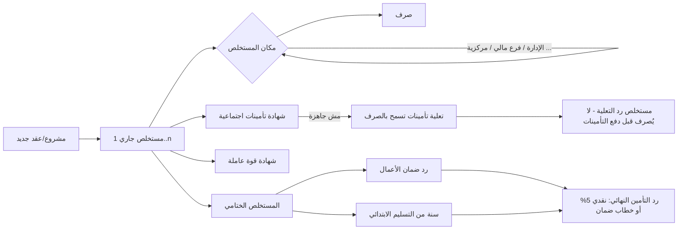

# PROJECT MASTER — المرجع الرئيسي

> تاريخ الإعداد: 2026-11-09 · المرجع: commit `07e8ad8` على `main` · **التحديثات اللي بعده لحد `ca2f488`:** [UPDATE_2026-11-11](UPDATE_2026-11-11.md)
> رموز الثقة: **[V]** = VERIFIED · **[I]** = INFERRED · **[U]** = UNKNOWN

## 1. التعريف
| البند | القيمة |
|---|---|
| اسم البرنامج | «متابعة المستخلصات» (العنوان الداخلي الافتراضي: «كشف متابعة المستخلصات الجارية») **[V]** |
| المالك | شركة الدمام للمقاولات العامة **[V]** (من الواجهة والإعدادات) |
| الشركات داخل البرنامج | شركة الدمام للمقاولات العامة، شركة الرباط لأعمال الطرق، عمرو كمال عليان الديب **[V]** (من `config/main`) |
| الاسم التقني | مستودع `eldamam-mostakhlasat`، ومشروع Supabase `mostakhlasat` **[V]** |

## 2. المشكلة اللي بيحلها
شركة مقاولات عندها عشرات المشاريع مع جهات حكومية (إدارة المهندسين العسكريين، إدارة المشروعات الكبرى، …). كل مشروع عليه **مستخلصات** (فواتير أعمال جارية وختامية). كل مستخلص بيعدّي على **أماكن** (الإدارة، فرع مالي، مركزية، …) لحد ما يتصرف، ومحتاج **شهادة تأمينات اجتماعية** و**شهادة قوة عاملة**. وبعد الختامي فيه مبالغ لازم ترجع للشركة: **رد ضمان الأعمال** و**رد التأمين النهائي**.

قبل البرنامج كانت المتابعة على شيت Excel. البرنامج بيوحّد البيانات، ويبيّن المتأخر، ويطلع كشوف وتقارير، ويشتغل من أكتر من جهاز في نفس الوقت، حتى من غير نت.

## 3. المستخدمين والأدوار
| الدور | قيمة `profiles.role` | الصلاحية | المصدر |
|---|---|---|---|
| مدير | `admin` | قراءة وتعديل كل البيانات + إدارة المستخدمين (على مستوى قاعدة البيانات) | **[V]** RLS + `src/shim.js` |
| محرر | `editor` | قراءة وتعديل كل البيانات | **[V]** |
| مشاهد | `viewer` | قراءة بس (البرنامج بيعرض «عرض فقط») | **[V]** |

المستخدمين الحاليين (2026-11-09) **[V]**: حسابين، الاتنين `admin`:
- «المدير»
- «خالد»

الإيميلات في [ACCOUNTS_AND_ACCESS](ACCOUNTS_AND_ACCESS.md). ومفيش أي دور اسمه Manager أو Employee: الأدوار تلاتة بس.

## 4. الوحدات (Modules) **[V]** (من `src/app.html`)
| الوحدة | التبويب (`state.tab`) | الوظيفة |
|---|---|---|
| نظرة عامة | `home` | مؤشرات عامة، غير المصروف حسب المكان والإدارة، مدة البقاء، أكبر المشاريع، حركة الأسبوع، آخر التعديلات، ولوحة مستحقات ما بعد الختامي |
| كشف المتابعة | `sat` | المستخلصات المعلّم عليها «عرض في كشف المتابعة»، مجمّعة إدارة ← مكان ← شركة، مع فلاتر وتنبيهات وتقرير PDF وExcel |
| حركة المستخلصات | `moves` | سجل انتقال المستخلصات بين الأماكن والصرف، ومدة البقاء في كل مكان |
| سجل المستخلصات | `inv` | كل المستخلصات مجمّعة بالمشروع أو غيره، مع عمليات جماعية |
| المشاريع | `proj` | بطاقات أو جدول للمشاريع (العقود) وحالتها |
| التأمينات الاجتماعية | `ins` | ملفات التأمينات لكل مستخلص، والمطلوب دفعه، وحاسبة التأمينات، ورد التعلية |
| مستحقات ما بعد الختامي | `co` | رد ضمان الأعمال ورد التأمين النهائي (نقدي 5% أو خطاب ضمان)، مع تنبيهات وتقرير |
| القوة العاملة | `mp` | تقدير مبالغ صندوق العمالة غير المنتظمة وشهادة القوة العاملة |

التفاصيل الكاملة لكل شاشة في [FEATURES_AND_WORKFLOWS](FEATURES_AND_WORKFLOWS.md).

## 5. دورة العمل الكاملة

## 6. أهم قواعد العمل (Business Rules) **[V]** من الكود
| القاعدة | التنفيذ (`src/app.html`) |
|---|---|
| صافي المستخلص الجاري = الإجمالي التراكمي − إجمالي المستخلص السابق من نفس النوع على نفس العقد (بالترتيب `order`) | `calc()` و`prevWork()` |
| أنواع المستخلص غير «مستخلص أعمال» (رد ضمان، رد تأمين، تعلية، فرق مصرح بصرفة): الصافي = الإجمالي، **ومش بتدخل في الأعمال المنفذة ولا في نسبة التنفيذ** | `isWork()`، `projStats()` |
| بعد الخامات = الصافي − Σ(كمية × سعر) | `calc()` |
| قيمة العقد = قيمة العقد بعد التخفيض لو أكبر من صفر، وإلا الإجمالي | `contractVal()` |
| نسبة التنفيذ = الإجمالي التراكمي ÷ قيمة العقد | `calc()` |
| المتأخر = مستخلص لم يُصرف في نفس المكان أكتر من `lateDays` يوم (الافتراضي 30)، وده للجهات اللي ليها مراحل بس | `calc()` |
| «الإدارة (تموين)» و«الإدارة (ميزانية)» أماكن فرعية تحت «الإدارة» | `stageSplit()` |
| حاسبة التأمينات: الوعاء = القيمة × 100 ÷ (100 + الضريبة، والافتراضي 14)، والتأمينات = الوعاء × نسبة العمالة × 18.25% | `insDialog()` |
| التعلية بتسمح بصرف المستخلص من غير الشهادة. ومستخلص «رد التعلية» مش بيتصرف غير بعد شهادة الأصلي أو انتهاء ملف التأمينات | `raiseReady()` |
| ملف التأمينات بيختفي من الكشف لما الشهادة تطلع | `insCertDone()` |
| القوة العاملة المتوقعة = max(0, الأساس × نسبة الأجور × نسبة القوة العاملة − المسدد سابقاً) | `mpRow()` |
| التأمين النهائي متاح للمطالبة في الأبعد بين (تاريخ الختامي/التسليم الابتدائي + سنة) و(تاريخ صرف ضمان الأعمال بالكامل) | `coCompute()` |
| التأمين النهائي النقدي: القيمة الافتراضية 5% من قيمة العقد لحد ما تتسجل القيمة الفعلية | `coCompute()` |
| تعديل تاريخ المستخلص الختامي محتاج سبب، وبيتسجل في `dateLog` | `invDialog()` |

## 7. التقنيات والإصدارات
| المكون | الإصدار | المصدر |
|---|---|---|
| الواجهة | HTML + CSS + JavaScript عادي (Vanilla)، **من غير Framework ولا npm** | **[V]** |
| مكتبة Supabase للمتصفح | ملف `site/supabase.js` مدموج؛ بداخله أرقام الإصدارات `2.45.4` و`2.65.0` | **[V]** الملف موجود / **[I]** الإصدار الدقيق لـ supabase-js |
| Excel منسّق | ExcelJS 4.4.0 من cdnjs | **[V]** |
| Excel بسيط | SheetJS xlsx 0.18.5 من cdnjs | **[V]** |
| الخطوط | IBM Plex Sans Arabic + Readex Pro من Google Fonts | **[V]** |
| أداة البناء | Python 3 + Pillow (للأيقونات). اتجرب على Python 3.13.18 وPillow 12.3.0 | **[V]** |
| قاعدة البيانات | Supabase (PostgreSQL) | **[V]** / إصدار Postgres **[U]** |
| الاستضافة | GitHub Pages عبر GitHub Actions | **[V]** |
| PWA | Service Worker + Manifest، ويتسطب على الكمبيوتر والموبايل | **[V]** |

## 8. الحالة الحالية (2026-11-09)
- **شغال ومنشور [V]:** كل الوحدات اللي فوق، والدخول، والمزامنة والشغل من غير نت، والتثبيت كبرنامج، والواجهة المتجاوبة على الموبايل، والتقارير.
- **البيانات الحية [V]:**
  - 67 مشروع
  - 136 مستخلص (و2 محذوفين حذف ناعم)
  - 17 ملف تأمينات
  - 10 متابعات ما بعد الختامي
  - 86 سجل نشاط
  - مستند إعدادات واحد
- **مش متنفذ:** المرفقات (رفع الملفات)، واسترجاع كلمة السر من البرنامج، وشاشة لإدارة المستخدمين، واختبارات آلية داخل المستودع.

التفاصيل في [PROJECT_STATUS_AND_ROADMAP](PROJECT_STATUS_AND_ROADMAP.md).

## 9. تاريخ مختصر **[V]** (من git log ومن سجل العمل)
1. **قبل 2026-11-07:** البرنامج كان Artifact على claude.ai، وبياناته في تخزين Claude الداخلي.
2. **2026-11-07:**
   - البيانات اتنقلت لـ Supabase.
   - اتعملت شاشة دخول.
   - النشر اتنقل من Netlify (اللي كان مقفول على شبكة الشركة) لـ GitHub Pages.
   - اتعمل الشغل من غير نت والتثبيت كبرنامج.
3. **2026-11-08:**
   - تحسينات التأمينات (حاسبة، رد تعلية).
   - تصغير النوافذ.
   - سجل متابعة للمستخلصات.
   - الواجهة المتجاوبة.
   - تخفيض العقد.
   - وحدة مستحقات ما بعد الختامي.

السجل الكامل: `git log` (27 commit).
