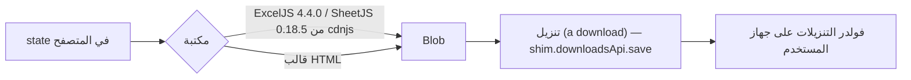

# STORAGE DOCUMENTATION — أماكن تخزين البيانات والملفات

> تاريخ الإعداد: 2026-11-09

## 1. الخلاصة (VERIFIED)
**البرنامج مفيهوش أي رفع ملفات من المستخدمين.** مفيش صور مستخدمين، ولا مرفقات، ولا PDF أو Excel مرفوع، ولا Object Storage. اتأكدت من ده بالبحث في الكود:
- مفيش `input type="file"`.
- مفيش `FileReader`.
- مفيش `supabase.storage` ولا `.upload(`.

المرفقات كانت مطلوبة في وحدة «مستحقات ما بعد الختامي» وما اتنفذتش. فبالتالي:
- **Buckets:** مفيش.
- **روابط ملفات عامة أو خاصة:** مفيش.
- **صلاحيات ملفات:** مفيش.

لو اتضاف رفع ملفات بعد كده، الاقتراح: Supabase Storage bucket خاص (private) + RLS على `storage.objects` + مسار الملف يتحفظ في JSON المستند. وتحدّث الملف ده وقتها.

## 2. فين البيانات موجودة فعلاً
| النوع | المكان | الوصول | النسخ الاحتياطي |
|---|---|---|---|
| كل بيانات البرنامج (مشاريع، مستخلصات، تأمينات، ما بعد الختامي، إعدادات، سجل نشاط) | Supabase ← جدول `public.docs` | Dashboard أو SQL، والتفاصيل في [DATABASE_DOCUMENTATION](DATABASE_DOCUMENTATION.md) | [BACKUP_AND_RECOVERY](BACKUP_AND_RECOVERY.md) |
| المستخدمين وأدوارهم | Supabase ← `auth.users` + `public.profiles` | Dashboard ← Authentication، وTable Editor | نفس اللي فوق |
| لوجو الشركة | مدموج كـ base64 جوه `src/app.html` (الثابت `LOGO_NAVY`) | في الكود | بيتحفظ مع git |
| أيقونات البرنامج | بيتولدوا من اللوجو في `site/*.png` | في المستودع | git |
| الكود | GitHub | [ACCOUNTS_AND_ACCESS](ACCOUNTS_AND_ACCESS.md) | git |

## 3. التخزين على جهاز المستخدم (بيتمسح لو المتصفح اتمسح، والنسخة الأصلية دايماً في Supabase)
| المخزن | الاسم | المحتوى |
|---|---|---|
| IndexedDB | `mostakhlasat-offline` (v1)، والمخازن: `server`, `pending`, `meta` | نسخة من كل صفوف `docs`، والتعديلات المنتظرة للإرسال، وآخر مزامنة ومالك الجهاز |
| localStorage | `sb-vaoubvghpktwjpdzdjnu-auth-token` (INFERRED: الاسم القياسي لـ supabase-js) | جلسة الدخول |
| localStorage | `profile:<uid>`, `profilesCache` | الاسم والدور، وأسماء المستخدمين لسجل النشاط |
| localStorage | `tab`, `satFilter2`, `dense`, `sideMini`, `pView`, `invNew` | تفضيلات العرض |
| Cache Storage | `shell-<version>`, `runtime-v1` | ملفات البرنامج والمكتبات والخطوط للشغل من غير نت |

**خطر:** التعديلات اللي في `pending` ولسه ماتبعتتش موجودة على الجهاز بس. عشان كده:
- زرار «خروج» بيحذّر قبل ما يمسحها.
- البرنامج بيطلب `navigator.storage.persist()` عشان المتصفح ميمسحهاش لوحده.

## 4. الملفات اللي البرنامج بيطلّعها (تنزيل بس)
بتتولد في المتصفح وبتنزل على جهاز المستخدم. **مش بتتحفظ على أي سيرفر.**
| الملف | الدالة |
|---|---|
| كشف المتابعة Excel منسّق | `exportSatXlsx` (ExcelJS) |
| تقرير الكشف PDF (صفحة HTML بتطبع نفسها) | `buildSatPdf` / `exportSatHtml` |
| سجل المستخلصات Excel | `exportInvXlsx` |
| المحدد Excel | `exportSelXlsx` |
| الحركة Excel | `exportMovesXlsx` |
| التأمينات Excel + HTML للطباعة | `exportInsXlsx` / `exportInsHtml` |
| مستحقات ما بعد الختامي Excel + HTML | `exportCoXlsx` / `exportCoHtml` |
| القوة العاملة Excel | `exportMpXlsx` |
| «الشيت المصدر» (نسخة احتياطية جزئية) | `exportBackup` |

## 5. الأسئلة الـ 12 للملفات المرفوعة
مفيش ملفات مرفوعة، فالأسئلة الخاصة بمكان التخزين والـ bucket والروابط والصلاحيات والحذف والنسخ والاستعادة **لا تنطبق (N/A)**. VERIFIED.
