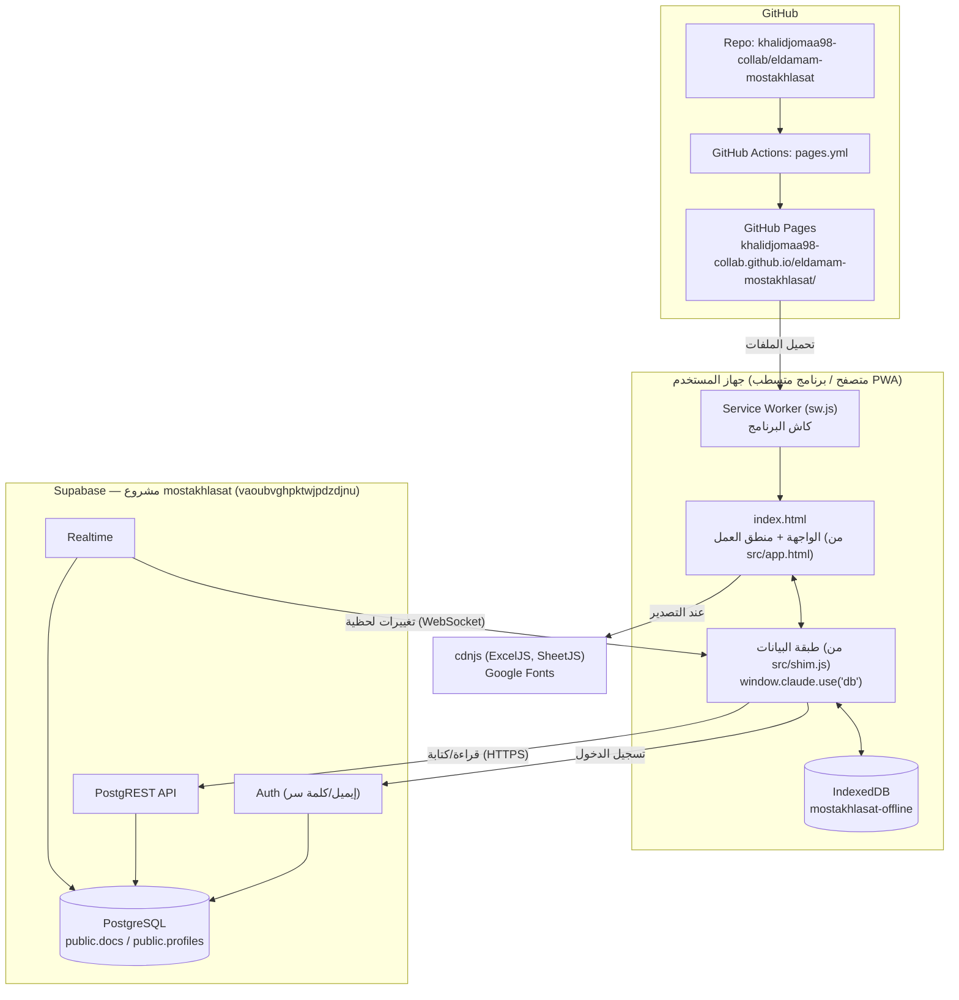
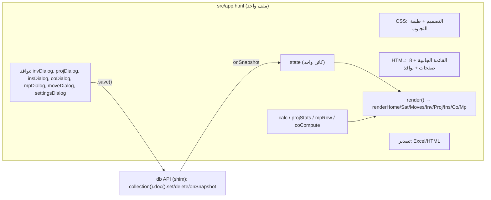
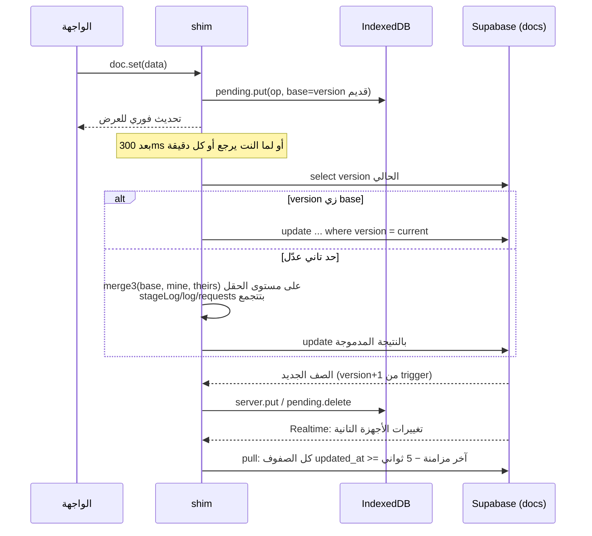
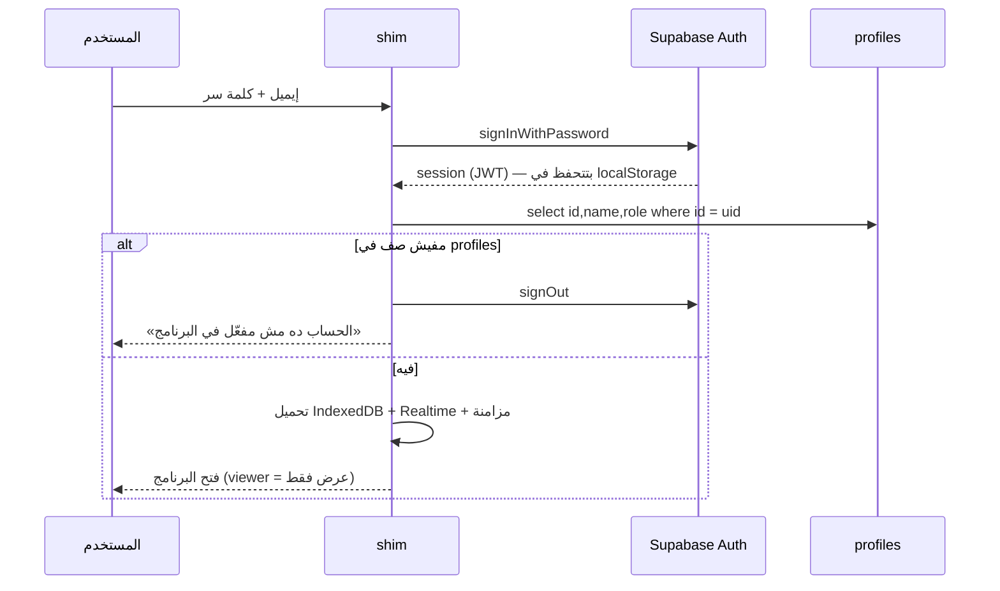
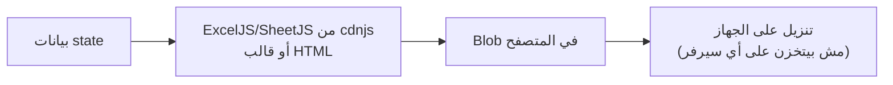
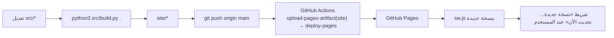

# SYSTEM ARCHITECTURE — المعمارية

> تاريخ الإعداد: 2026-11-09 · كل اللي في الملف ده **VERIFIED** من الكود إلا لو اتكتب غير كده.

## 1. الصورة الكاملة

**مفيش Backend خاص بالبرنامج.** المنطق كله في المتصفح، وSupabase بيقدم قاعدة البيانات والدخول والـ API والـ Realtime. والأمان معتمد على Row Level Security جوه Postgres.

## 2. طبقات الواجهة (Frontend)

- **إدارة الحالة:** كائن واحد اسمه `state` (المشاريع والمستخلصات والتأمينات والمتابعات والإعدادات والفلاتر). أي تغيير في البيانات بيعمل `render()` كامل، وفيه كاش `memo` للحسابات.
- **مفيش Router:** التبويب في `state.tab` وبيتحفظ في `localStorage`.

## 3. طبقة البيانات والمزامنة (`src/shim.js`)

- **الحذف ناعم** (`deleted=true`) عشان يوصل لكل الأجهزة.
- **لو المستخدم اتغير على نفس الجهاز** بيتمسح التخزين المحلي (`meta.owner`).
- **عند الخروج:** بيتمسح التخزين المحلي، وبيحذّر لو فيه تعديلات لسه ماتبعتتش.

## 4. معمارية قاعدة البيانات
التفاصيل والـ ERD في [DATABASE_DOCUMENTATION](DATABASE_DOCUMENTATION.md):
- جدول بيانات واحد (`docs`) بمفتاح مركب (collection, id) وقيمة JSONB.
- جدول `profiles` مربوط بـ `auth.users`.
- العلاقات بين المستندات منطقية جوه JSON (زي `invoices.data.projectId` اللي بيشاور على `projects.id`) ومش Foreign Keys.

## 5. تسجيل الدخول

**أوفلاين:** لو فيه جلسة محفوظة وprofile متخزن في `localStorage`، البرنامج بيفتح من غير نت.

## 6. API
كل الاتصال من المتصفح لـ Supabase مباشرة بمكتبة supabase-js:
- **REST:** `/rest/v1/docs` و`/rest/v1/profiles` (select / insert / update مع شرط version).
- **Auth:** `/auth/v1` (token, user).
- **Realtime:** WebSocket على `postgres_changes` لجدول `docs`.

مفيش APIs تانية. التفاصيل في [APIS_AND_INTEGRATIONS](APIS_AND_INTEGRATIONS.md).

## 7. رفع وتنزيل الملفات
- **رفع ملفات:** مش موجود.
- **التنزيل:** ملفات Excel وHTML بتتولد في المتصفح وبتتنزل على جهاز المستخدم. التفاصيل في [STORAGE_DOCUMENTATION](STORAGE_DOCUMENTATION.md).

## 8. النشر

التفاصيل في [DEPLOYMENT_GUIDE](DEPLOYMENT_GUIDE.md).

## 9. الكاش والـ Service Worker (`src/sw.js`)
| الطلب | الاستراتيجية |
|---|---|
| ملفات البرنامج (نفس الموقع) | من الكاش الأول (`shell-<version>`)، وأي فتحة صفحة غير معروفة بترجع `index.html` |
| Supabase | مش بيتكاش؛ بيروح للشبكة دايماً |
| cdnjs وGoogle Fonts | من الكاش الأول (`runtime-v1`) |

- **رقم النسخة:** hash بيتحسب في `build.py` من محتوى `index.html` و`shim.js` و`sw.js` والأيقونات والـ manifest.
- **التحديث:** التثبيت بيستخدم `cache:"reload"` عشان النسخة الجديدة متتاخدش من كاش المتصفح القديم.
- **تنبيه:** طالما الـ Service Worker الأساسي متسطب، أي صفحة جديدة تحت نفس المسار بتفتح بـ `index.html` القديم من الكاش (اللي اتعمل بيه رابط `/preview/` واتشال بعد كده).
